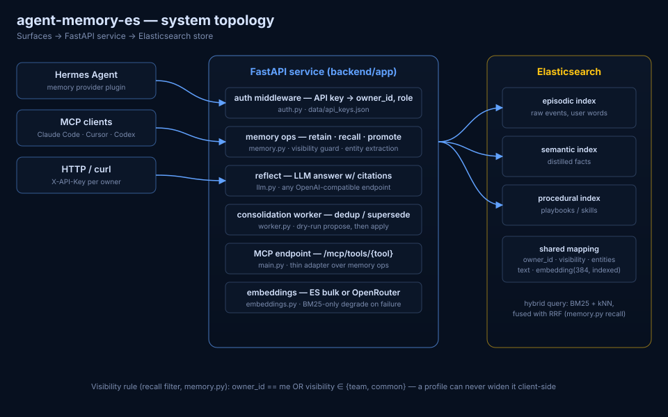
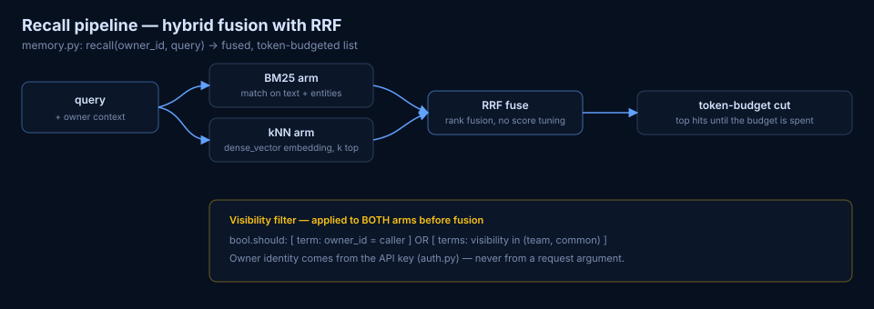

# Architecture — agent-memory-es

> Grounded in `backend/app/*.py` as of this commit; every claim names its source file. Diagrams: [topology](diagrams/architecture.svg) · [recall pipeline](diagrams/recall-pipeline.svg). Interactive walkthrough: [explainer](explainer.html).

## System topology



Three planes:

| Plane | Component | Source |
|---|---|---|
| **Surfaces** | Hermes memory-provider plugin, MCP endpoint, plain HTTP | `backend/hermes_plugin/agent_memory_es`, `main.py:87` |
| **Service** | FastAPI app: auth, memory ops, reflect, consolidation worker | `backend/app/main.py` |
| **Store** | Elasticsearch, three indices (episodic / semantic / procedural) | `store.py` (`KINDS`, `MAPPINGS`, `ensure_indices`) |

## Memory model

Every document carries the same envelope (`store.py` MAPPINGS):

- `kind` ∈ `episodic` (raw events — the user's words, never the assistant's), `semantic` (distilled facts), `procedural` (playbooks/skills)
- `owner_id` — bound to the API key that wrote it
- `visibility` ∈ `private` / `team` / `common`
- `text`, `entities` (keyword-extracted, `memory.py:extract_entities`), `embedding` (384-dim dense_vector, indexed), `occurred_at`, `active`

## API surface (`main.py`)

| Route | Purpose |
|---|---|
| `POST /memory/retain` | store a memory (kind + visibility) |
| `POST /memory/recall` | hybrid search, visibility-filtered |
| `POST /memory/promote` | private → team/common, guarded |
| `POST /memory/consolidate` | dedup/supersede pass |
| `POST /memory/reflect` | LLM answer over recalled evidence, with citations (`llm.py`) |
| `POST /mcp/tools/{tool}` | thin MCP adapter over the same ops |
| `POST /admin/keys` | mint API key (X-Admin-Token) |
| `GET /health` | liveness + embed/fusion truth, always **200** while the process serves: `degraded`, `embed_ok` (live probe, one attempt, 5 s cap, cached 60 s and refreshed in the background), `vector_arm`, `embed_error`, `fusion`, `license_status`, `docs_without_vector_occurred_24h` (docs with `occurred_at` in the last 24 h and no vector; counted by `occurred_at`, not by write time), `embed_failures` (per-process, backend only: it resets on restart and is not shared between the API and the worker) |
| `GET /health/ready` | same body, **503** while degraded (embed probe failing). Use this for readiness gates and alerts; `/health` stays a liveness probe |

## Tenancy & isolation

- **Identity**: API key → `owner_id` + role (`auth.py`, keyfile `data/api_keys.json`). The owner is *never* a request argument.
- **Read filter** (`memory.py:_visibility_filter`): `owner_id == caller OR visibility ∈ {team, common}` — applied to both retrieval arms, so a client cannot widen visibility.
- **Write guard** (`memory.py:guard_promotion`): deterministic marker regex blocks promoting a private memory that contains sensitive markers (api key, token, secret, …) to team/common. Same text, same decision — no classifier involved.
- **Rejection tombstones** (`tombstone.py`): the user's "forget this / that's wrong" verdicts block re-learning the same value at retain time.

## Recall pipeline



1. **BM25 arm** — match over `text` + `entities`
2. **kNN arm** — dense_vector top-k (embeddings via ES `_bulk` inference or any OpenAI-compatible endpoint, `embeddings.py`; on embedding failure the system degrades to BM25-only — `memory.py:retain` swallows the embed error)
3. **RRF fusion** — rank-based, no score tuning across arms
4. **Token-budget cut** — top fused hits until the budget is spent

## Consolidation worker (`worker.py`)

Background loop (default every 600 s, `AMES_CONSOLIDATE_INTERVAL`): for every known owner, a **dry-run pass** proposes duplicates/supersessions (visibility only), then an **apply pass** supersedes old semantic facts; `keep_both` cases are surfaced, never auto-merged. Superseded docs are flagged inactive — audit history preserved.

## Deployment (`backend/docker-compose.yml`)

`ames-backend` (uvicorn :8123) + `ames-worker` + a Elasticsearch instance; `AMES_ADMIN_TOKEN` required. Env knobs: `AMES_ES_URL`, `AMES_EMBED_BACKEND`, `AMES_LLM_BASE` (OpenAI-compatible endpoint for reflect).

### Embedding backends and the license

- `es` calls `_inference/text_embedding`, which **needs an Elasticsearch license** that includes inference: when a trial expires it returns 403 and writes land without vectors. `omniroute` calls an external OpenAI-compatible gateway (different dimensions, so it needs its own index).
- `local` runs multilingual-e5-small in-process (onnxruntime + tokenizers) and is the **off-license setting**: it needs no `_inference`, and its vectors match the ES-hosted endpoint (cosine >= 0.9999 on the parity fixture). Both compose files set `AMES_EMBED_BACKEND: local`.
- With `AMES_EMBED_BACKEND` unset, auto-detect prefers `local` when `onnxruntime` and `tokenizers` import and `AMES_LOCAL_MODEL_DIR` holds a valid model; otherwise it probes `es`, then falls back to `omniroute`. An explicit value always wins.
- The model is never downloaded at runtime. The image build (`scripts/bake_e5_model.py`) fetches one pinned HF revision, verifies its sha256 and writes a `REVISION` marker; `embeddings.py` refuses a model dir whose marker differs from `LOCAL_MODEL_REVISION`, and `embed_error` names the missing path. `AMES_LOCAL_MODEL_ALLOW_FETCH=1` (default off) allows a download for dev checkouts and tests only.
- Parity fixture: `backend/scripts/capture_e5_parity.py` records ES-hosted vectors (read-only) together with the model id and node architecture.
- **Unset backend now means `local`.** With the new image (which bakes the model) an unset `AMES_EMBED_BACKEND` auto-selects `local`, where before it would have probed `es`. Set the variable explicitly to keep the old behaviour.
- **Memory cost is per process.** Every process that embeds (API, worker, fact-worker, backfill-worker) loads its own model and ONNX session; nothing is shared between them, so RAM scales with the number of those processes. Budget roughly 0.9–1.3 GiB peak RSS per embedding process (aarch64, m1max/OrbStack, no network): ~884 MiB after loading the model and one short embed, ~1278 MiB after a batch of 16 long (>512-token, truncated) passages; an idle container that has not loaded the model uses ~4 MiB, against ~180 MB for the es-backend images. Multiply by the services that load the model: the main compose sets `AMES_EMBED_BACKEND: local` on `ames-backend` and `ames-worker` (about 1.8–2.6 GiB together), and the r7 stack, which leaves it unset and so auto-selects `local`, runs three embedding services. The uvicorn (API) process, measured as container cgroup memory (off-prod on m1max, aarch64/OrbStack, image built at `ddf58be`, 838 MB, `AMES_EMBED_BACKEND` unset so it auto-selects `local`, throwaway ES), used 791 MiB (anon 785 MiB) after the startup warm-up and 804 MiB (anon 786 MiB) 20 s later at idle. The API process loads its session in a background thread at startup. While that load runs, `/health` does not wait for it: it returns 200 at once with `degraded: true` and `embed_error: "loading"` (and `/health/ready` is 503), and goes healthy as soon as the load finishes. In that run `/health` answered "loading" in 25 ms, and about 3 s after container start `embed_ok` was true and `/health/ready` returned 200.
- **Parity is verified on aarch64 only.** The committed fixture was captured from an aarch64 ES node and the in-image check ran on aarch64; no x86_64 host has been tested. To verify on x86_64, on that host (with the model cache present, or `AMES_LOCAL_MODEL_ALLOW_FETCH=1` once to populate it) run from `backend/`:
  `AMES_REQUIRE_MODEL=1 python -m pytest tests/test_local_embed_and_fusion.py tests/test_capture_e5_parity.py -q`
  `AMES_REQUIRE_MODEL=1` makes a missing model a failure instead of a skip; the run must report zero skips in these two files. A cosine below 0.9999 on any item means the x86 build does not match the ES-hosted vectors.

### Fusion

`AMES_FUSION` is `app` (default: BM25 + kNN fused in Python, RRF k=60, window 50) or `es` (`retriever.rrf`, needs a paid/trial license). The app-side tie-break is deterministic: on exactly equal RRF scores the better best-rank wins, then the lexical list, then the id. This differs from ES's `retriever.rrf` on exact ties only, which is accepted.

## Hermes integration

The standalone plugin ([hermes-plugin-agent-memory-es](https://github.com/patrykkopycinski/hermes-plugin-agent-memory-es)) registers three agent tools — `agent_memory_recall`, `agent_memory_retain`, `agent_memory_reflect` — maps Hermes turn sync to the episodic tier, and mirrors built-in memory writes into the semantic tier. A copy ships in `backend/hermes_plugin/agent_memory_es` for reference.

## Testing

`backend/tests/` — API behavior, auth migration, promotion guard, tombstones, consolidation, worker, reflect, plus a recall eval harness (`eval_recall.py`).

Tests that need the live reflect LLM gateway (`test_hermes_adapter.py`, `test_reflect_llm.py`, `test_reflect_no_llm`) skip with a reason naming `AMES_LLM_BASE` when it is unreachable (`tests/_llm_gate.py`, 2 s probe).

### Running the whole suite on a remote host

`scripts/test-remote.sh` runs the full suite from your machine on a docker host (default `m1max`) against a throwaway Elasticsearch, never against prod:

```
scripts/test-remote.sh [--ref REF] [--base REF] [--host SSH] [--port 9291] [--keep-es] [-- pytest args]
scripts/test-remote.sh --collect RUN_ID     # re-attach after a dropped ssh / killed runner
scripts/test-remote.sh --abort RUN_ID
```

- Ships the whole repo at `--ref` (and `--base`) with `git archive` (tests load `../../scripts/*`), starts `ames-review-es-<port>` (ES 9.6, 1 GB heap) and runs pytest in a container from the prod backend image (`docker inspect ames-backend`) with `AMES_EMBED_BACKEND=local` and a per-run `amtest_` index prefix.
- Takes the ops-claim `<host>:ames-review-es` (exit 75 when held), refuses with exit 70 below `AMES_TEST_MIN_FREE_MB` (4096) free memory, and always removes its containers, trees and claim on exit.
- With `--base` it prints NEW / fixed / pre-existing failure sets and exits 1 on any NEW failure. `AMES_MIN_TESTS` (50) is a positive control: a run that executed fewer tests fails.
- Exit codes: 0 green, 1 failures, 64 refused (bad args, reserved ports 9200/9220/9268/9279), 70 infra, 75 busy. Logs and junit land in `~/.cache/ames-test-remote/`.
- All state is on the host, so long runs are detached and polled; the run id is printed on the first line.
